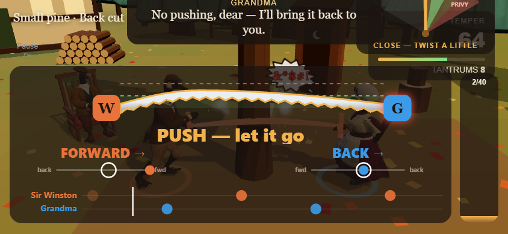
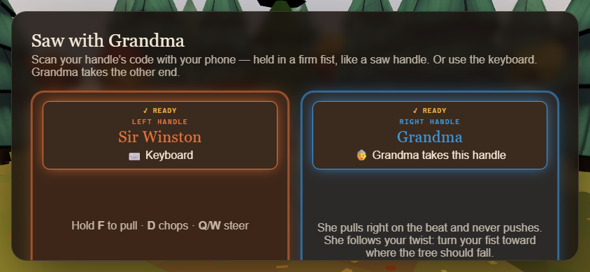
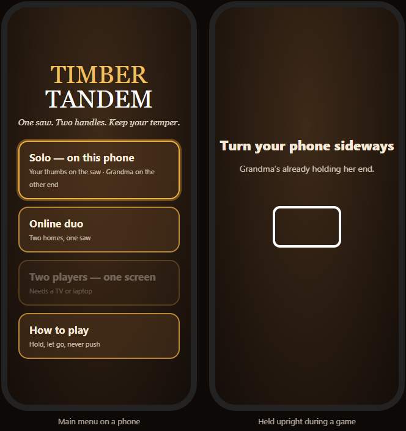
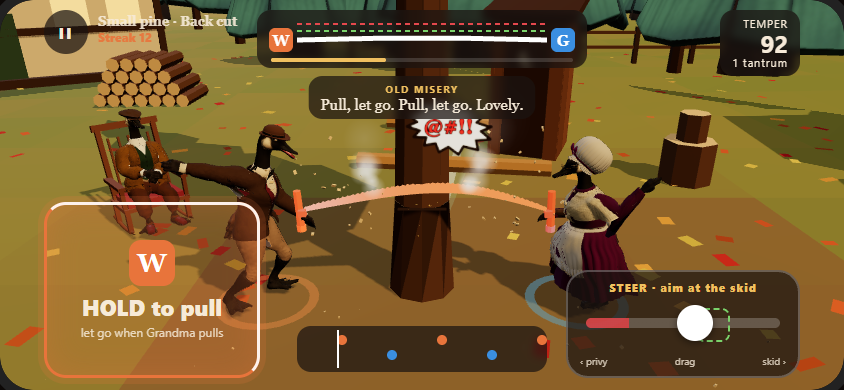
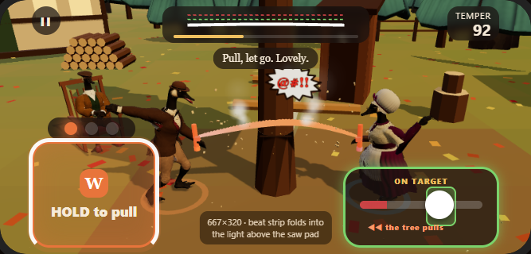
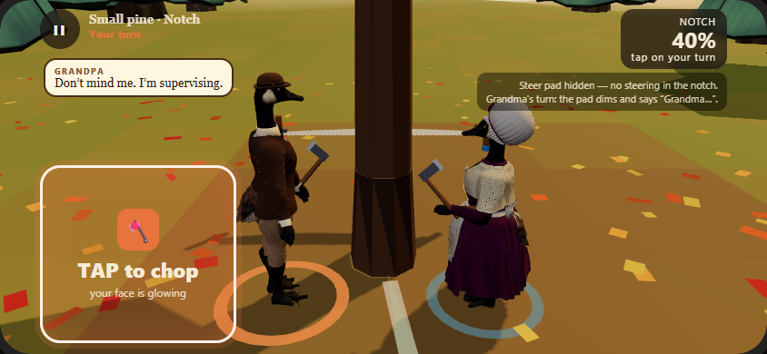
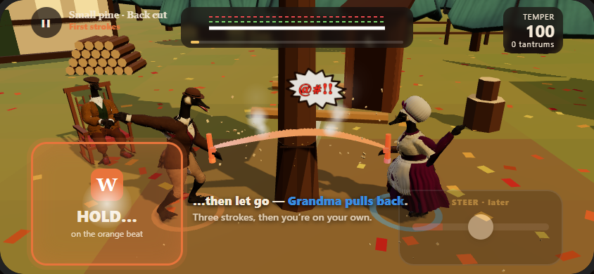
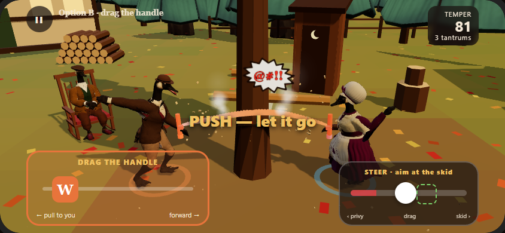

# Touch solo: play on just your phone

**Status:** Pete answered the questions on 2026-10-25 (§9). T0–T2 are built, and T3 partly (§10).

**Goal:** someone with only a phone opens timber.housetandem.com, taps **Solo**, turns the phone sideways and saws with Grandma using their thumbs. No TV, no second phone and no QR code.

**Not in scope:** motion on the same phone you're watching (you can't read a screen you're shaking); couch play on a phone; portrait play; new verbs (wedge, limbing, heave, plant aren't built yet, and §13.2 of the plan already maps them to touch for later).

---

## 1. What happens today on a phone

The phone shows the TV page, laid out for a TV:

| | |
|---|---|
|  |  |

- **Solo means "phone remote or keyboard".** The lobby asks you to scan a QR code with your phone, which is the device you're already holding. On a phone there's no keyboard.
- **The saw panel covers the scene.** At 844×390 the blade, the beat strip, the stroke sliders and the aim dial cover almost the whole screen, and the TANTRUM! banner sits on top of Old Misery's caption.
- **Grandpa's bubble already copes:** it docks when he's off-screen, so it needs no change.

The screenshots were taken at 844×390 from `feat/grandpa-tales` (Grandpa's bubble isn't on main yet) with `scripts/dev-phone-shots.mjs`. The mockups are drawn over them by `scripts/dev-touch-mockups.mjs` from `docs/mockups/touch-solo/mockups.html`.

## 2. The idea in one line

**A touch seat is a keyboard seat with thumbs.** The touch pads call the same `game.key('A', 'pull' | 'chop' | 'left' | 'right', down)` the keyboard does. The saw model, Grandma's bot, scoring and the phases don't change. The same `HoldPull` already drives both the keyboard and the phone remote's "saw by touch" mode, so a touch score means the same as a keyboard score.

Two new things in the game logic, both on the keys seat, so the keyboard and touch get them alike:
- **Analog steering.** Keys give a roll of −1, 0 or +1; the steer pad gives any value in between (`s.keys.roll`, used in place of `left/right` when set).
- **The tree's pull** (§4a). Keyboard and touch steering is otherwise free, so these two seats fight a drifting lean. The phone remote doesn't get it: holding a twist in your fist while you saw is already the hard way to steer.

## 3. Getting in

- **Which devices count as a phone:** `matchMedia('(pointer: coarse) and (hover: none)')` and no physical keyboard used yet. A tablet counts too. The first real key press switches back to the keyboard layout.
- **Main menu on a phone** (upright is fine here):
  - **Solo — on this phone** goes straight to the game: seat A = touch, seat B = Grandma. The QR lobby is skipped because there's nothing to pair.
  - **Online duo** stays. Touch there is a later follow-up (§9).
  - **Two players — one screen** (local multiplayer) is shown greyed out, labelled "Needs a TV or laptop".
- **The safety card is skipped** for touch, because nothing is swung. Same for the lesson (calibration), which keyboard seats already skip.
- **Turn sideways.** If the phone is upright during a game, a full-screen card says "Turn your phone sideways — Grandma's already holding her end." The game pauses behind it.
- **Tapping Solo** is the user gesture that unlocks audio, takes the Wake Lock, and on Android asks for fullscreen plus `screen.orientation.lock('landscape')`. iPhone Safari has no fullscreen for pages, so the safe-area insets do the work there. Add to Home Screen (a manifest with `display: fullscreen`) gives a clean full screen.

## 4. The layout while sawing

Sideways, two thumbs. The scene stays visible in the middle.

| Zone | What | Size |
|---|---|---|
| **Bottom left: the saw pad** | Your handle (orange **W**). **Hold to pull, let go when Grandma pulls.** Your thumb covers the middle of the pad, so the beat cue sits where you can still see it: the pad's **outer edge** fills on your beat, and a **light just above the pad** flashes orange on your beat and blue on Grandma's. The pad's whole area is live, and a thumb that slides off it still counts as held until it lifts. | about 40% of the screen height, square-ish |
| **Bottom right: steer** | **You fight it** (§4a). The knob is always being pulled toward one side, as if the tree wants to lean that way, and you hold it on the target against that pull. Let go and it slides off to that side. The target is a **tall band** that reaches above the track, so you can see it around your thumb. The **whole pad's border turns green** while you're on target, so you can feel it without looking straight at it. The red end is the privy. This replaces the TV's aim dial: the control shows its own target. | about 40% of the screen height, wider than tall |
| **Bottom middle: beat strip** | The two-lane strip from the TV, small: your dots on odd beats, Grandma's on even ones. | 250×46 |
| **Top middle: blade strip** | The blade with its live bow and the green and red lines, the handle chips at each end, and the cut bar underneath. This is the TV's saw panel shrunk to one strip. The stroke sliders and FORWARD/BACK labels are dropped, because the pad shows your state. | 330×58 |
| **Top right** | Temper and tantrums. | chip |
| **Top left** | Pause button (a plain tap; there's no fist to guard against) and the tree name. | 44 pt |
| **Captions** | They move from the bottom (where the thumbs are) to under the blade strip, two lines at most. The big TANTRUM! word moves down to the middle of the scene so it never covers a caption. | |

Everything sits inside `env(safe-area-inset-*)`, so the camera cutout and home bar never cover a pad.

**Short screens.** The mockups are 844×390, but Safari's bars take space when the phone is sideways, and a small iPhone sideways (667×375) leaves about **320 px** of height. So the pads, strips and type scale with the screen height (`vh`/`clamp()`), not fixed points. Below about 340 px the beat strip folds into the light above the saw pad, and captions drop to one line. The touch smoke runs at 844×390 and 667×320.

### 4a. The tree's pull (keyboard and touch)

- **What:** every tree has a lean, a pull of between about a quarter and two-thirds of full steer toward one side. Now and then (every 6–12 s) it eases to a new strength, and sometimes it switches sides. Strength and timing get tuned in play.
- **How it acts:** the steering that counts is *your input + the pull*. To aim straight you hold against it.
  - **Touch:** hold the knob off-centre against the pull. Let go and it slides to the pull side.
  - **Keyboard:** hold or tap Q/W against it. With no key down, the lean drifts to the pull side.
  - **Phone remote:** no pull. The twist is the challenge already.
- **Where it shows:** on touch, the "◀◀ the tree pulls" arrow on the steer pad. On the TV, the same arrow sits on the aim dial for keyboard seats.
- **When:** only while sawing, and **not during the first-strokes coach**. You learn the saw first, then the fight. Grandma follows your steering as she does now.

## 5. Each phase

| Phase | On a phone |
|---|---|
| Title | Menu as in §3 |
| Lobby | Skipped in touch solo |
| Safety card, lesson | Skipped (§3) |
| Cold open | Tap anywhere to skip, as the TV's skip button does now |
| **Notch** | The saw pad becomes the **hatchet pad: tap to chop** when your face glows. On Grandma's turn it dims and says "Grandma…". The steer pad is hidden.  |
| **Saw** | §4. **First strokes are coached** the first time: a ghost thumb pulses on the pad: "Hold… then let go — Grandma pulls back." After three clean strokes the coach goes away and steering lights up. This takes the lesson's place.  |
| Fall | No input. Pads fade out, and Grandpa's call shows as it does now |
| Score, end | The existing buttons, at touch size (44 pt minimum). Grandpa's tale bubble stays over the card |
| Paused | The existing pause sheet; tap Resume |

## 6. Feel

- **Haptics (Android only):** a 10 ms tick when a stroke bites, a 15 ms tick on a chop, and a double buzz on a tantrum. iPhone Safari has no vibration API, so on iPhone the sounds do the work, as they already can (§4.9 of the plan: playable by ear).
- **Sound:** the same cues as on the TV. Phones play through their own speaker, so lower the music bed a notch on touch to keep the hum and rasp clear.
- **The iPhone silent switch.** Web Audio on iPhone goes quiet when the ringer switch is off, and iPhones have no vibration, so a muted phone would give no feedback at all. Set `navigator.audioSession.type = 'playback'` (Safari 17+) on the Solo tap so the game plays through the switch, as a video does.
- **Latency:** a touch is felt instantly and the game runs on the phone, so there's no network or sensor delay. That's easier than the phone remote.

## 7. Performance

The scene must hold 60 fps on a mid-range phone.
- Phones start at `quality: 'medium'` (pixel ratio 1.5, no shadow maps).
- If frames take longer than 22 ms for 3 s, drop to `low` and keep that choice for the device.
- Measure on a real iPhone and a real mid-range Android before step T3 passes (§8).

## 8. Build steps (gates, not dates)

| Step | What | Done when |
|---|---|---|
| **T0** | Phone detection, the menu on a phone, Solo goes straight to touch seat A + Grandma, the rotate card | The smoke reaches the notch with an emulated iPhone |
| **T1** | Saw and hatchet pads, the steer pad with analog roll, the tree's pull for keyboard and touch (§4a), the compact phone HUD that scales with height (§4), captions moved | A new `touch` smoke scenario fells a tree with simulated touches at 844×390 and at 667×320: temper ≥ 90, no page errors. A unit test shows the pull drifts the lean with no input and that holding against it keeps it on target. All 10 existing scenarios still pass (the keyboard smokes steer against the pull) |
| **T2** | The first-strokes coach | The coach shows once, then goes away after three clean strokes |
| **T3** | Haptics, the iPhone silent-switch audio fix, fullscreen/orientation on Android, Wake Lock, the Add to Home Screen manifest, the quality drop | 60 fps on Pete's phones; Pete plays a tree on an iPhone and an Android |

## 9. Pete's answers (2026-10-25)

1. **Saw input: hold to pull (A)** for now. Drag-the-handle (B) stays on the shelf.
2. **Steering is actively managed:** a pull toward one side that you have to fight (§4). It doesn't simply spring back to the middle, and it doesn't stay where you leave it.
   - The pull is the **tree's own lean** (§4a). **Keyboard gets it too; the phone remote doesn't**, because the twist is already hard. Strength and timing get tuned in play.
3. **Two players (local multiplayer) on a phone:** greyed out. Online multiplayer is coming soon.
4. **Online duo by touch:** later.
5. **Landscape only**, with the rotate card.

The original questions

1. Hold to pull (A) or drag the handle (B)? 
2. Spring-back steering or a knob that stays put?
3. Two players on a phone: grey out or hide?
4. Online duo by touch now or later?
5. Landscape only?

## 10. What's built (2026-10-25)

**Try it:** open the PR preview on a phone, turn it sideways and tap **Solo — on this phone**. On a desktop, add `?touch` to the URL.

| Step | Status |
|---|---|
| **T0** | ✅ The phone menu (Solo on this phone; Two players greyed out, "Needs a TV or laptop"). One tap goes straight to the cold open, with no lobby, safety card or lesson. Rotate card, and the game pauses if the phone is turned upright. `?host=solo&touch` reloads into it. |
| **T1** | ✅ Saw pad (hold to pull; the edge fills on your beat; HOLD / LET GO tells you what to do now), hatchet pad in the notch, steer pad with analog roll, a tall target band and a green border when on target. The tree's pull works for touch and keyboard (`core/tree-pull.js`), and the TV aim dial shows "TREE PULLS" for keyboard seats. The TV HUD folds into a strip at the top, and captions move up. |
| **T2** | ✅ The first-strokes coach, first tree of the visit only. The pull starts after 3 bites. |
| **T3** | Partly. ✅ Android haptics, the iPhone silent-switch audio fix, Wake Lock, Android fullscreen + landscape lock, phones start at medium quality. ⏳ Still to do: the automatic drop to low quality, the Add to Home Screen manifest, and measuring on real phones. |

**Different from the mockups:** the beat strip stays inside the top strip under the blade, not between the pads. The light above the saw pad carries the beat for your thumbs, and on short screens (under 340 px) the strip is dropped.

**Tests:** `tree-pull.test.mjs` (5 unit tests), and a new `touch` smoke scenario. It taps through the phone menu, plays a whole tree with pointer events on the real pads (chopping, sawing on the beat, steering against the pull), checks the layout at 844×390 and 667×320, and checks the rotate card.
